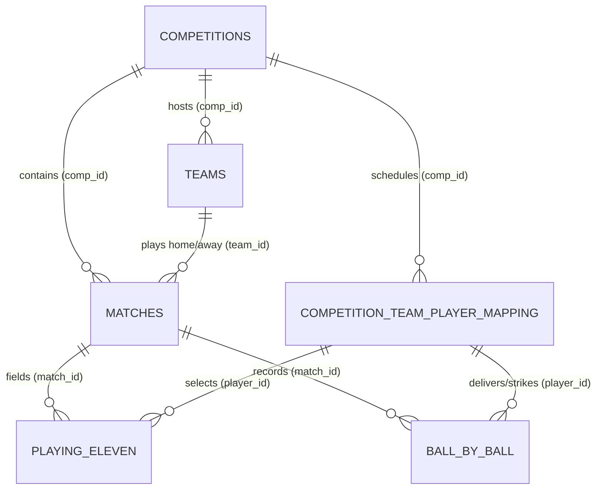

# Data Audit Report: Operation Pink Panther
**Project**: Rajasthan Royals SupeRR Selector Season 2 - Round 1  
**Brand**: PinkOps  
**Date Generated**: 2026-11-12 20:13:53  
**Data Engineer**: Lead Data Engineer, Operation Pink Panther  
**Raw Data Status**: Read-Only / Immutable (`data/raw/`)  

> [!IMPORTANT]
> This report represents Stage 1 (Data Discovery, Validation, and Setup). In strict adherence to project guidelines, **no player selections, pressure weighting models, thresholds, or performance rankings** have been applied.

---

## 1. Files Discovered

A thorough inspection of `data/raw/` identified the competition archive (`6af458274c1e8_data_pack.zip`) and extracted competition files. All metadata files from OS utilities (`__MACOSX`, `.DS_Store`) were identified and isolated.

| File Name | Relative Path | File Type | File Size | Size (Bytes) | Role / Content |
| :--- | :--- | :--- | :--- | :--- | :--- |
| `ball_by_ball.csv` | `data/raw/6af458274c1e8_data_pack/Data Pack/ball_by_ball.csv` | `.csv` | 39.2 MB | 41,071,837 | Raw Competition Dataset |
| `competition_team_player_mapping.csv` | `data/raw/6af458274c1e8_data_pack/Data Pack/competition_team_player_mapping.csv` | `.csv` | 452.1 KB | 462,969 | Raw Competition Dataset |
| `competitions.csv` | `data/raw/6af458274c1e8_data_pack/Data Pack/competitions.csv` | `.csv` | 7.4 KB | 7,624 | Raw Competition Dataset |
| `matches.csv` | `data/raw/6af458274c1e8_data_pack/Data Pack/matches.csv` | `.csv` | 121.0 KB | 123,864 | Raw Competition Dataset |
| `playing_eleven.csv` | `data/raw/6af458274c1e8_data_pack/Data Pack/playing_eleven.csv` | `.csv` | 943.6 KB | 966,287 | Raw Competition Dataset |
| `Round 1 Problem Statement _ SupeRR Selector Season 2.docx.pdf` | `data/raw/6af458274c1e8_data_pack/Data Pack/Round 1 Problem Statement _ SupeRR Selector Season 2.docx.pdf` | `.pdf` | 248.1 KB | 254,082 | Competition Document / Problem Brief |
| `teams.csv` | `data/raw/6af458274c1e8_data_pack/Data Pack/teams.csv` | `.csv` | 6.8 KB | 6,922 | Raw Competition Dataset |
| `6af458274c1e8_data_pack.zip` | `data/raw/6af458274c1e8_data_pack.zip` | `.zip` | 4.3 MB | 4,545,438 | Raw Compressed Archive |

- **PDF Validation**: Problem statement `Round 1 Problem Statement _ SupeRR Selector Season 2.docx.pdf` contains **2 pages** specifying requirements for two top-10 player ranking lists (batters and bowlers) under pressure and a methodology report.

## 2. Table Schemas

The 6 relational CSV tables possess the following schemas, physical datatypes, and semantic descriptions:

### 2.1 `competitions.csv` (Shape: 141 rows × 4 columns)

| Column Name | Inferred Dtype | Null Count | Null % | Unique Count | PK Candidate |
| :--- | :--- | :--- | :--- | :--- | :--- |
| `comp_id` | `int64` | 0 | 0.00% | 141 | Yes (Single) |
| `comp_name` | `str` | 0 | 0.00% | 141 | Yes (Single) |
| `match_format` | `str` | 0 | 0.00% | 2 | No |
| `season` | `str` | 0 | 0.00% | 8 | No |

### 2.2 `teams.csv` (Shape: 353 rows × 3 columns)

| Column Name | Inferred Dtype | Null Count | Null % | Unique Count | PK Candidate |
| :--- | :--- | :--- | :--- | :--- | :--- |
| `comp_id` | `int64` | 0 | 0.00% | 141 | Composite Component |
| `team_id` | `int64` | 0 | 0.00% | 38 | Composite Component |
| `team_name` | `str` | 0 | 0.00% | 38 | No |

### 2.3 `matches.csv` (Shape: 883 rows × 22 columns)

| Column Name | Inferred Dtype | Null Count | Null % | Unique Count | PK Candidate |
| :--- | :--- | :--- | :--- | :--- | :--- |
| `match_id` | `int64` | 0 | 0.00% | 883 | Yes (Single) |
| `comp_id` | `int64` | 0 | 0.00% | 138 | Composite Component |
| `match_number` | `int64` | 0 | 0.00% | 75 | No |
| `match_date` | `str` | 0 | 0.00% | 686 | No |
| `stage` | `str` | 0 | 0.00% | 7 | No |
| `venue_id` | `int64` | 0 | 0.00% | 98 | Composite Component |
| `venue_country` | `str` | 0 | 0.00% | 17 | No |
| `home_team_id` | `int64` | 0 | 0.00% | 36 | Composite Component |
| `home_team` | `str` | 0 | 0.00% | 36 | No |
| `away_team_id` | `int64` | 0 | 0.00% | 36 | Composite Component |
| `away_team` | `str` | 0 | 0.00% | 36 | No |
| `home_team_captain_id` | `float64` | 44 | 4.98% | 89 | Composite Component |
| `away_team_captain_id` | `float64` | 45 | 5.10% | 98 | Composite Component |
| `toss_win_team_id` | `float64` | 15 | 1.70% | 37 | Composite Component |
| `toss_opted` | `str` | 15 | 1.70% | 2 | No |
| `man_of_the_match` | `int64` | 0 | 0.00% | 293 | No |
| `first_inn_revised_overs` | `float64` | 858 | 97.17% | 13 | No |
| `second_inn_revised_overs` | `float64` | 858 | 97.17% | 12 | No |
| `revised_target` | `float64` | 860 | 97.40% | 23 | No |
| `knock_out` | `int64` | 0 | 0.00% | 2 | No |
| `win_team_id` | `float64` | 41 | 4.64% | 36 | Composite Component |
| `result` | `str` | 0 | 0.00% | 670 | No |

### 2.4 `competition_team_player_mapping.csv` (Shape: 6,413 rows × 6 columns)

| Column Name | Inferred Dtype | Null Count | Null % | Unique Count | PK Candidate |
| :--- | :--- | :--- | :--- | :--- | :--- |
| `comp_id` | `int64` | 0 | 0.00% | 140 | Composite Component |
| `comp_name` | `str` | 0 | 0.00% | 140 | No |
| `team_id` | `int64` | 0 | 0.00% | 38 | Composite Component |
| `team_name` | `str` | 0 | 0.00% | 38 | No |
| `player_id` | `int64` | 0 | 0.00% | 1,217 | Composite Component |
| `player_name` | `str` | 0 | 0.00% | 1,210 | No |

### 2.5 `playing_eleven.csv` (Shape: 28,381 rows × 9 columns)

| Column Name | Inferred Dtype | Null Count | Null % | Unique Count | PK Candidate |
| :--- | :--- | :--- | :--- | :--- | :--- |
| `match_id` | `int64` | 0 | 0.00% | 880 | Composite Component |
| `team_id` | `int64` | 0 | 0.00% | 38 | Composite Component |
| `player_id` | `int64` | 0 | 0.00% | 1,082 | Composite Component |
| `batting_order` | `float64` | 8,678 | 30.58% | 13 | No |
| `is_played` | `bool` | 0 | 0.00% | 2 | No |
| `is_captain` | `object` | 8,667 | 30.54% | 2 | No |
| `is_wk` | `object` | 8,667 | 30.54% | 2 | No |
| `is_impact` | `int64` | 0 | 0.00% | 2 | No |
| `is_impact_off` | `int64` | 0 | 0.00% | 2 | No |

### 2.6 `ball_by_ball.csv` (Shape: 200,999 rows × 33 columns)

| Column Name | Inferred Dtype | Null Count | Null % | Unique Count | PK Candidate |
| :--- | :--- | :--- | :--- | :--- | :--- |
| `match_id` | `int64` | 0 | 0.00% | 867 | Composite Component |
| `innings` | `int64` | 0 | 0.00% | 4 | No |
| `overid` | `int64` | 0 | 0.00% | 20 | Composite Component |
| `over_ball_num` | `int64` | 0 | 0.00% | 13 | No |
| `innings_ball_num` | `int64` | 0 | 0.00% | 136 | No |
| `batting_team_id` | `int64` | 0 | 0.00% | 38 | Composite Component |
| `bowling_team_id` | `int64` | 0 | 0.00% | 38 | Composite Component |
| `striker_id` | `int64` | 0 | 0.00% | 888 | Composite Component |
| `striker_name` | `str` | 0 | 0.00% | 885 | No |
| `non_striker_id` | `int64` | 0 | 0.00% | 867 | Composite Component |
| `non_striker_name` | `str` | 0 | 0.00% | 864 | No |
| `bowler_id` | `int64` | 0 | 0.00% | 647 | Composite Component |
| `bowler_name` | `str` | 0 | 0.00% | 646 | No |
| `batting_type` | `str` | 0 | 0.00% | 2 | No |
| `bowling_type` | `str` | 0 | 0.00% | 12 | No |
| `batting_order` | `int64` | 0 | 0.00% | 13 | No |
| `runs` | `int64` | 0 | 0.00% | 7 | No |
| `is_four` | `bool` | 0 | 0.00% | 2 | No |
| `is_six` | `bool` | 0 | 0.00% | 2 | No |
| `is_wicket` | `bool` | 0 | 0.00% | 2 | No |
| `dismissal_type_id` | `float64` | 190,118 | 94.59% | 8 | Composite Component |
| `dismissal_type` | `str` | 190,118 | 94.59% | 9 | No |
| `dismissed_player_id` | `float64` | 190,107 | 94.58% | 814 | Composite Component |
| `extras_type` | `str` | 189,167 | 94.11% | 6 | No |
| `extras1_runs` | `int64` | 0 | 0.00% | 6 | No |
| `extras_2_runs` | `int64` | 0 | 0.00% | 3 | No |
| `pace_or_spin` | `str` | 0 | 0.00% | 2 | No |
| `bowl_speed` | `float64` | 0 | 0.00% | 1,033 | No |
| `stroke` | `str` | 6,158 | 3.06% | 30 | No |
| `delivery_style` | `str` | 391 | 0.19% | 34 | No |
| `over_or_around` | `str` | 407 | 0.20% | 2 | No |
| `on_or_off` | `str` | 0 | 0.00% | 2 | No |
| `delivery_ist_time` | `str` | 0 | 0.00% | 200,826 | No |

## 3. Row Counts

| Table Name | Row Count | Column Count | Distinct Entities Modeled | Exact Duplicate Rows |
| :--- | :--- | :--- | :--- | :--- |
| `competitions.csv` | 141 | 4 | 141 Competitions | 0 |
| `teams.csv` | 353 | 3 | 38 Distinct Teams (across 141 Comps) | 0 |
| `matches.csv` | 883 | 22 | 883 Matches | 0 |
| `competition_team_player_mapping.csv` | 6,413 | 6 | 1,217 Distinct Players across 140 Comps | 0 |
| `playing_eleven.csv` | 28,381 | 9 | 28,381 Match Lineup Entries | 0 |
| `ball_by_ball.csv` | 200,999 | 33 | 200,999 Pitch Deliveries | 0 |

## 4. Missing Values

Detailed analysis of columns containing missing values (`null` / `NaN`):

| Table | Column Name | Null Count | Null % | Structural Cause / Meaning |
| :--- | :--- | :--- | :--- | :--- |
| `matches.csv` | `home_team_captain_id` | 44 | 4.98% | Captain not designated or match abandoned before toss |
| `matches.csv` | `away_team_captain_id` | 45 | 5.10% | Captain not designated or match abandoned before toss |
| `matches.csv` | `toss_win_team_id` | 15 | 1.70% | Toss not conducted (abandoned due to rain/outfield) |
| `matches.csv` | `toss_opted` | 15 | 1.70% | Toss not conducted |
| `matches.csv` | `win_team_id` | 41 | 4.64% | Matches ending in No Result (21), Abandoned (19), or Tied (1) |
| `matches.csv` | `first_inn_revised_overs` | 858 | 97.17% | Standard uncurtailed 20-over matches |
| `matches.csv` | `second_inn_revised_overs` | 858 | 97.17% | Standard uncurtailed 20-over matches |
| `matches.csv` | `revised_target` | 860 | 97.40% | Standard uncurtailed 20-over matches (no DLS) |
| `playing_eleven.csv` | `batting_order` | 8,678 | 30.58% | 8,667 bench squad members (`is_played=False`) + 11 in match 48512 |
| `playing_eleven.csv` | `is_captain` | 8,667 | 30.54% | Unused bench squad members (`is_played=False`) |
| `playing_eleven.csv` | `is_wk` | 8,667 | 30.54% | Unused bench squad members (`is_played=False`) |
| `ball_by_ball.csv` | `dismissal_type_id` | 190,118 | 94.59% | Non-wicket deliveries |
| `ball_by_ball.csv` | `dismissal_type` | 190,118 | 94.59% | Non-wicket deliveries |
| `ball_by_ball.csv` | `dismissed_player_id` | 190,107 | 94.58% | Non-wicket deliveries (except 12 retired hurt cases) |
| `ball_by_ball.csv` | `extras_type` | 189,167 | 94.11% | Legal deliveries without extras |
| `ball_by_ball.csv` | `stroke` | 6,158 | 3.06% | Leaves, unoffered deliveries, wides, or sensor telemetry gaps |
| `ball_by_ball.csv` | `delivery_style` | 391 | 0.19% | Missing delivery style classification |
| `ball_by_ball.csv` | `over_or_around` | 407 | 0.20% | Missing bowling angle telemetry |

## 5. Duplicate Records

- **Exact Full-Row Duplicates**: **0 duplicate rows** across all 6 raw tables.
- **Partial / Entity Duplicates in `playing_eleven.csv`**:
  - In `playing_eleven.csv`, exactly **3 matches** contain duplicated player records for the same match:
    - **Match `13613`**: 34 total rows, 22 unique players, **12 duplicate player rows** (players assigned multiple batting order numbers).
    - **Match `21176`**: 33 total rows, 22 unique players, **11 duplicate player rows** (players assigned multiple batting order numbers).
    - **Match `28962`**: 39 total rows, 22 unique players, **17 duplicate player rows** (players assigned multiple batting order numbers).
  - **Mitigation Requirement**: When joining or counting appearances, deduplicate `playing_eleven` using `subset=['match_id', 'player_id']` or take `batting_order.min()`.

## 6. Primary-Key Candidates

| Table | Primary Key Candidate | Type | Uniqueness Verified | Key Evaluation & Justification |
| :--- | :--- | :--- | :--- | :--- |
| `competitions.csv` | `comp_id` | Single Column | **Verified Unique (141/141)** | Clean integer surrogate primary key. |
| `teams.csv` | `(comp_id, team_id)` | Composite (2-col) | **Verified Unique (353/353)** | Teams appear across multiple competitions; pair uniquely identifies team per tournament. |
| `matches.csv` | `match_id` | Single Column | **Verified Unique (883/883)** | Canonical match identifier. |
| `competition_team_player_mapping.csv` | `(comp_id, player_id)` | Composite (2-col) | **Verified Unique (6,413/6,413)** | Uniquely maps player to their tournament squad roster. |
| `playing_eleven.csv` | Synthetic Row ID | Surrogate | **Needs Dedup** | Natural `(match_id, player_id)` has 40 duplicate records across 3 matches. |
| `ball_by_ball.csv` | `(match_id, innings, innings_ball_num)` | Composite (3-col) | **Verified Unique (200,999/200,999)** | Monotonically increments 1..N per innings. Alternative: `(match_id, innings, overid, over_ball_num)`. |

## 7. Foreign-Key Relationships

## 8. Referential-Integrity Checks

Every expected relational link was programmatically tested against the data:

| Join Relationship | Parent Table | Child Table | Foreign Key Column | Orphans Found | Integrity Verdict | Notes |
| :--- | :--- | :--- | :--- | :--- | :--- | :--- |
| Matches -> Competitions | `competitions` | `matches` | `comp_id` | **0** | **100% Valid** | All 883 matches reference a valid `comp_id`. (3 comps have no matches). |
| Teams -> Competitions | `competitions` | `teams` | `comp_id` | **0** | **100% Valid** | All 353 team-comp rows reference a valid `comp_id`. |
| Mapping -> Competitions | `competitions` | `mapping` | `comp_id` | **0** | **100% Valid** | All 6,413 mapping rows reference a valid `comp_id`. |
| Home Team -> Teams | `teams` | `matches` | `home_team_id` | **0** | **100% Valid** | All home teams exist in `teams.csv`. |
| Away Team -> Teams | `teams` | `matches` | `away_team_id` | **0** | **100% Valid** | All away teams exist in `teams.csv`. |
| Win Team -> Teams | `teams` | `matches` | `win_team_id` | **0** | **100% Valid** | All non-null winners exist in `teams.csv`. (41 nulls for no result/tied). |
| Playing XI -> Matches | `matches` | `playing_eleven` | `match_id` | **0** | **100% Valid** | All 28,381 p11 rows reference a valid `match_id`. (3 abandoned matches missing p11). |
| Ball-by-Ball -> Matches | `matches` | `ball_by_ball` | `match_id` | **0** | **100% Valid** | All 200,999 deliveries reference a valid `match_id`. (16 abandoned matches have 0 balls). |
| Strikers -> Player Mapping | `mapping` | `ball_by_ball` | `striker_id` | **0** | **100% Valid** | All 888 unique strikers exist in player mapping. |
| Non-Strikers -> Mapping | `mapping` | `ball_by_ball` | `non_striker_id` | **0** | **100% Valid** | All 867 unique non-strikers exist in player mapping. |
| Bowlers -> Player Mapping | `mapping` | `ball_by_ball` | `bowler_id` | **0** | **100% Valid** | All 647 unique bowlers exist in player mapping. |
| Dismissed -> Player Mapping | `mapping` | `ball_by_ball` | `dismissed_player_id` | **0** | **100% Valid** | All 814 unique dismissed players exist in player mapping. |
| Playing XI -> Player Mapping | `mapping` | `playing_eleven` | `player_id` | **0** | **100% Valid** | All 1,082 unique players in p11 exist in player mapping. |
| Captains -> Player Mapping | `mapping` | `matches` | `captain_ids` | **0** | **100% Valid** | All home/away captain IDs exist in player mapping. |
| Man of Match -> Mapping | `mapping` | `matches` | `man_of_the_match` | **0** | **100% Valid** | All 764 non-zero MotM IDs exist in player mapping (119 have sentinel `0`). |

> [!NOTE]
> **Cross-Table Anomaly (Active Players Missing from Lineups)**: Exactly **2 players across 3 matches** appeared on the field in `ball_by_ball.csv` but were omitted from `playing_eleven.csv` for that match:
> - Match `37095` (Pakistan A vs United Arab Emirates, 2024-10-23): Player `39444` (**Basil Hameed**)
> - Match `37087` (United Arab Emirates vs Oman, 2024-10-19): Player `39444` (**Basil Hameed**)
> - Match `37092` (India A vs United Arab Emirates, 2024-10-21): Player `39444` (**Basil Hameed**)
> - Match `37095` (Pakistan A vs United Arab Emirates, 2024-10-23): Player `36153` (**Syed Haider**)
> - Match `37092` (India A vs United Arab Emirates, 2024-10-21): Player `36153` (**Syed Haider**)
> - Match `37087` (United Arab Emirates vs Oman, 2024-10-19): Player `36153` (**Syed Haider**)
> These occurrences are confined to United Arab Emirates matches in the ACC Men's T20 Emerging Teams Asia Cup 2024.

## 9. Date and Competition Coverage

- **Earliest Match Date**: `2022-01-22` (England in West Indies T20I Series)
- **Latest Match Date**: `2026-11-01` (Pakistan in Sri Lanka T20I Series)
- **Calendar Span**: ~4 years and 9 months (January 2022 to November 2026)

### Format & Competition Distribution

| Match Format | Competitions Count | Matches in Data | Ball-by-Ball Deliveries | Scope Summary |
| :--- | :--- | :--- | :--- | :--- |
| `T20I` (International) | 134 | 482 | 106,327 | Bilateral series, World Cups, Asia Cups, Tri-series |
| `T20` (Franchise / Tournaments) | 7 | 401 | 94,672 | IPL (5 seasons, 371 matches) + Emerging Teams (30 matches) |

### Season Breakdown

| Season | Total Matches | IPL Matches | T20I Matches | Other T20 |
| :--- | :--- | :--- | :--- | :--- |
| `2022` | 168 | 74 | 94 | 0 |
| `2022/23` | 12 | 0 | 12 | 0 |
| `2023` | 137 | 74 | 63 | 0 |
| `2023/24` | 3 | 0 | 3 | 0 |
| `2024` | 198 | 74 | 109 | 15 |
| `2024/25` | 3 | 0 | 3 | 0 |
| `2025` | 216 | 75 | 126 | 15 |
| `2026` | 146 | 74 | 72 | 0 |

### IPL Season Coverage (371 Matches Total)
- **IPL 2022** (comp_id 1358): 74 matches
- **IPL 2023** (comp_id 1715): 74 matches
- **IPL 2024** (comp_id 2193): 74 matches
- **IPL 2025** (comp_id 2725): 75 matches
- **IPL 2026** (comp_id 3298): 74 matches

## 10. Ball-by-Ball Structure

The delivery-level data contains 200,999 records structured as follows:

### 10.1 Innings & Super Overs
- **Innings 1**: 105,727 deliveries across 867 matches (min: 2 balls [rain], max: 135 balls, mean: 121.9)
- **Innings 2**: 95,234 deliveries across 845 matches (min: 7 balls [chase cutoff], max: 136 balls, mean: 112.7)
- **Innings 3 (Super Over 1st Innings)**: 25 deliveries across **6 matches**
- **Innings 4 (Super Over 2nd Innings)**: 13 deliveries across **6 matches**
- **Matches with Super Overs in Delivery Data**: `[34429, 40725, 45512, 48027, 48029, 50359]` (e.g. Match 34429 IND vs SL, Match 40725 DC vs RR, Match 45512 IND vs AFG, Match 48027 BAN-A vs IND-A, Match 48029 BAN-A vs PAK-A, Match 50359 KKR vs RR).

### 10.2 Over and Ball Numbering
- `overid`: 1-indexed, ranging from **1 to 20** (Over 1 represents the first over of the innings).
- `over_ball_num`: 1-indexed sequential physical ball counter within over, ranging from **1 to 13** (reaches 13 in overs with multiple wides/no-balls).
- `innings_ball_num`: 1-indexed sequential delivery counter across the entire innings, ranging from **1 to 136**.
- **Delivery Sequencing Gaps**: **Zero gaps detected**. Every recorded innings has uninterrupted delivery sequencing.

### 10.3 Scoring, Extras, and Boundaries
- **Batter Runs (`runs`)**:
  - `0` runs: 79,387 deliveries (39.50%)
  - `1` runs: 72,267 deliveries (35.95%)
  - `2` runs: 12,547 deliveries (6.24%)
  - `3` runs: 656 deliveries (0.33%)
  - `4` runs: 23,303 deliveries (11.59%)
  - `5` runs: 25 deliveries (0.01%)
  - `6` runs: 12,814 deliveries (6.38%)
- **Extras Breakdown (`extras_type`)**:
  - `Legal Ball (No Extras)`: 189,167 deliveries (94.11%)
  - `wide`: 7,714 deliveries (3.84%)
  - `legbyes`: 2,748 deliveries (1.37%)
  - `Overstep`: 576 deliveries (0.29%)
  - `byes`: 529 deliveries (0.26%)
  - `other`: 264 deliveries (0.13%)
  - `Penalty`: 1 deliveries (0.00%)
- **Dual Extras (`extras_2_runs > 0`)**: Exactly **36 deliveries** record additional runs resulting from overthrow/boundary conceded during a wide or no-ball.
- **Boundary Flag Verification**:
  - `runs == 4` and `is_four == True`: 23,283
  - `runs == 4` but `is_four == False`: **20 deliveries** (all-run 4s or overthrow boundaries not tagged as standard boundaries)
  - `runs == 6` and `is_six == True`: 12,811
  - `runs == 6` but `is_six == False`: **3 deliveries** (all-run sixes / overthrows in matches 17396, 31277, 40766)

### 10.4 Dismissals & Wicket Semantics
- Total Official Wickets (`is_wicket == True`): **10,881**
- Dismissal Types Recorded:
  - `Caught`: 7,557 (69.45% of wickets)
  - `Bowled`: 1,775 (16.31% of wickets)
  - `LBW`: 709 (6.52% of wickets)
  - `RunOut`: 600 (5.51% of wickets)
  - `Stump`: 214 (1.97% of wickets)
  - `Hit Wicket`: 17 (0.16% of wickets)
  - `Retire Out`: 6 (0.06% of wickets)
  - `Obstracting the field`: 2 (0.02% of wickets)
  - `Obstructing the field`: 1 (0.01% of wickets)

### 10.5 Bowling & Batting Styles and Telemetry
- **Pace vs Spin**: Pace: **123,886** (61.64%), Spin: **77,113** (38.36%).
- **Batting Hand**: RHB: **131,006** (65.18%), LHB: **69,993** (34.82%).
- **Bowling Styles**: 12 distinct classifications (e.g. Right-arm Leg-Break: 28,027, Right-arm medium-fast: 27,014, Right-arm Fast: 26,637).
- **Shot Categorization (`stroke`)**: 30 shot types recorded across 194,841 deliveries (top shots: Pull shot: 24,645, Cover Drive: 20,779, Worked: 20,757). 6,158 nulls.
- **Delivery Style**: 34 movement types (Seamed In: 22,058, Orthodox: 19,239, Leg Break: 15,449, Off Cutter: 15,143).

## 11. Data-Quality Issues

The audit uncovered several critical anomalies and edge cases that downstream pipeline stages must handle explicitly:

1. **Typographical Discrepancy in Dismissal Types**:
   - `Obstracting the field` (misspelled) appears 2 times.
   - `Obstructing the field` (standard spelling) appears 1 time.
   - *Action*: Normalise both to `Obstructing the field`.

2. **Radar Speed Telemetry Glitches (`bowl_speed`)**:
   - **77,862 deliveries (38.74%)** have `bowl_speed <= 0` (unrecorded telemetry or default placeholder).
   - **20 deliveries** have physically impossible speeds exceeding 165 km/h, up to **1456.1 km/h** (e.g., Khaleel Ahmed 1456.1 km/h, Romario Shepherd 1135.6 km/h, Ravindra Jadeja 967.0 km/h). These are decimal shift errors (1456.1 was intended as 145.6, 967.0 as 96.7).
   - *Action*: Never treat raw `bowl_speed` as valid without bounds filtering (divide values in [500, 1600] by 10, nullify negative/zero values).

3. **Retired Hurt vs Official Wickets**:
   - Exactly **12 deliveries** have `is_wicket == False`, `dismissal_type == NaN`, but `dismissed_player_id` is populated with the batter's ID (e.g. Rahul Tripathi, Rohit Sharma, Kane Williamson, Sanju Samson). These represent batters retiring hurt.
   - *Action*: Do not credit the bowler with a wicket on these balls; do not increment bowler wicket count.

4. **Retire Out Omitted Player ID**:
   - On delivery index 127899 (Match 40709, Innings 2, Over 19), Hardik Pandya was 'Retire Out' (`is_wicket = True`), but `dismissed_player_id` is `NaN`.
   - *Action*: Impute `dismissed_player_id = striker_id` when `dismissal_type == 'Retire Out'` and `dismissed_player_id` is null.

5. **Identical Player Names for Distinct Athletes (Name Collisions)**:
   - Exactly **7 player names** belong to two distinct cricketers:
     - **`Abdul Samad`**: 2 distinct athletes: ID `7446` (Sunrisers Hyderabad, Lucknow Super Giants) vs ID `6922` (Pakistan A, Pakistan)
     - **`Bashir Ahmad`**: 2 distinct athletes: ID `39479` (Afghanistan A) vs ID `29833` (Afghanistan)
     - **`Basil Hameed`**: 2 distinct athletes: ID `8638` (United Arab Emirates) vs ID `39444` (United Arab Emirates)
     - **`Haider Ali`**: 2 distinct athletes: ID `7338` (Pakistan, Pakistan A) vs ID `28756` (United Arab Emirates)
     - **`Mohammad Ali`**: 2 distinct athletes: ID `3083` (Pakistan) vs ID `20229` (Pakistan)
     - **`Muhammad Farooq`**: 2 distinct athletes: ID `27373` (United Arab Emirates) vs ID `28978` (United Arab Emirates)
     - **`Rashid Khan`**: 2 distinct athletes: ID `4722` (Gujarat Titans, Afghanistan) vs ID `20172` (Nepal)
   - *Action*: **MANDATORY**: Always join and aggregate by `player_id`, NEVER by `player_name`.

6. **Duplicated Player Entries in `playing_eleven.csv`**:
   - Matches `13613`, `21176`, `28962` have multiple rows per player with conflicting batting orders.
   - *Action*: Deduplicate match-player lineups before joining.

7. **Missing Lineups for Active Delivery Participants**:
   - In 3 UAE matches (37087, 37092, 37095), players Basil Hameed (39444) and Syed Haider (36153) participated in deliveries but are absent from `playing_eleven.csv`.
   - *Action*: When assessing player participation, derive active appearance from `ball_by_ball` deliveries in addition to `playing_eleven`.

## 12. Potential Analytical Opportunities

Based solely on data availability (without imposing subjective thresholds), the dataset affords the following objective signals for subsequent modeling:

1. **Chasing Match Context**: In Innings 2, exact target runs, balls remaining, wickets in hand, and live Required Run Rate (RRR) vs Current Run Rate (CRR) can be computed ball-by-ball.
2. **First Innings Collapse & Rebuilding**: Over-by-over score and wicket trajectory (e.g. top-order collapse: 3 wickets down inside the powerplay) allow modeling crisis management.
3. **Death Overs & High-Leverage Phases**: High-density death over deliveries (overs 16-20) with fine-grained tracking of extras, dot-ball pressure, and boundary concessions.
4. **Impact Player Context**: Distinguish between pre-2023 and 2023+ IPL matches where batting depth is artificially extended via the Impact Player rule (`is_impact`, `is_impact_off`).
5. **Knockout vs League Distinction**: The `knock_out` flag (31 matches) and `stage` field (Finals, Qualifiers, Eliminators) allow isolating tournament-elimination stakes.
6. **Match Closeness & Super Overs**: 6 Super Overs and 5 tied matches represent the absolute pinnacle of high-leverage situations.
7. **Pace vs Spin Matchups**: Granular classification of bowling type and release style enables evaluating batter and bowler reliability across specific tactical matchups.

## 13. Unknowns That Must Be Investigated

Before finalizing any pressure quantification logic in Round 1, the following analytical questions must be rigorously explored:

1. **Competition Weighting / Level of Opposition**: How should bilateral T20Is between Associate members (e.g. Hong Kong vs Oman, UAE in Nepal) be calibrated relative to elite IPL fixtures or India vs Australia clashes?
2. **Minimum Sample Size / Qualification Cutoffs**: What minimum delivery thresholds ensure that rankings reflect sustained reliability rather than single-match heroics or small-sample variance?
3. **First-Innings Pressure Quantification**: While second-innings pressure has an explicit target and required rate, what objective formulation best captures high-leverage situations in the first innings without arbitrary assumptions?
4. **DLS / Revised Target Adjustments**: For the 34 shortened matches, how should target recalculations be normalized so that truncated innings do not distort required run rate baselines?
5. **Player Baseline Formulation**: How should 'usual performance' (the denominator or baseline mentioned in the problem brief) be computed for each player to measure their elevation or drop under pressure?

## 14. Recommended Next Analytical Step

Now that the raw data is fully mapped, verified, and its structural characteristics cataloged, the recommended sequence of next steps is:

1. **Feature Engineering & Derived State Calculation (`src/02_build_match_state.py`)**:
   - Construct an enriched ball-by-ball feature table containing:
     - Cumulative score, cumulative wickets lost, balls remaining in innings.
     - Target runs, runs required, required run rate (RRR), and current run rate (CRR) for 2nd innings.
     - Normalized tournament quality tier (IPL vs Full Member T20I vs Associate T20I).
     - Cleaned bowling speed and normalised dismissal types.
2. **Pressure Formulation Design**:
   - Develop a mathematically grounded, objective pressure metric (e.g., win probability added leverage, required rate delta, or crisis index) that avoids arbitrary thresholds.
3. **Player Reliability Scoring Engine**:
   - Compute baseline performance vs pressure performance for both batters and bowlers.
   - Apply empirical Bayes shrinkage or sample-size weighting to ensure rankings prioritize high-confidence, high-volume contributors.

---
*Report produced by PinkOps Data Engineering Team | Project: Operation Pink Panther*